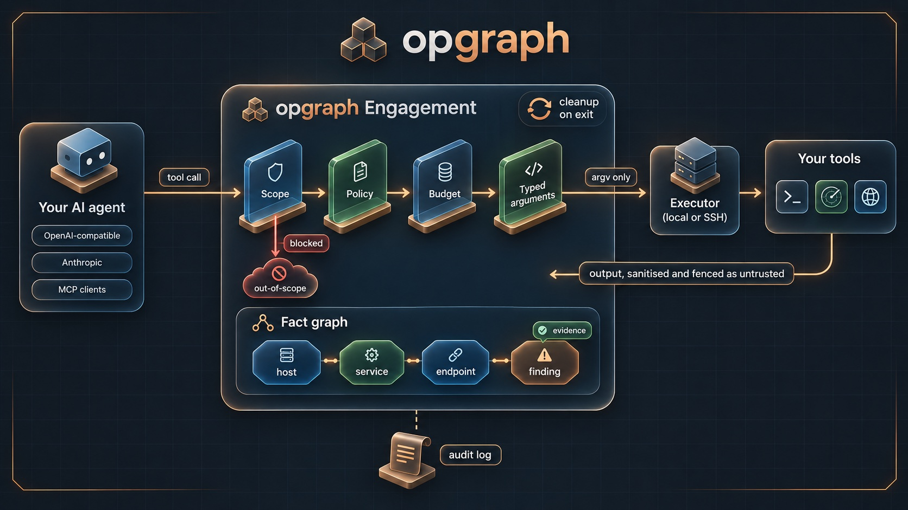

<p align="center">
  
</p>

<p align="center">
  <b>The safety and memory layer for AI pentest agents.</b><br>
  Typed actions, enforced scope, a shared fact graph and guaranteed cleanup,<br>
  for any agent framework and any model.
</p>

<p align="center">
  <a href="https://pypi.org/project/opgraph/"></a>
  <a href="https://pypi.org/project/opgraph/"></a>
  
  
  <a href="https://github.com/aswin-kevin/opgraph/actions/workflows/ci.yml"></a>
  <a href="https://github.com/aswin-kevin/opgraph/blob/main/LICENSE"></a>
</p>

<p align="center">
  <a href="https://github.com/aswin-kevin/opgraph#quickstart">Quickstart</a> ·
  <a href="https://github.com/aswin-kevin/opgraph#plug-it-into-your-agent">Plug it into your agent</a> ·
  <a href="https://github.com/aswin-kevin/opgraph#write-a-technique">Write a technique</a> ·
  <a href="https://github.com/aswin-kevin/opgraph#the-safety-model">Safety model</a> ·
  <a href="https://github.com/aswin-kevin/opgraph/tree/main/examples">Examples</a>
</p>

opgraph is **not** a pentest agent. It is the layer *between* the agent you are
building and the tools it runs. Your model decides what to try; opgraph decides
whether it is allowed, runs it, remembers what it learned, and cleans up after it.
For authorized testing only: see [Responsible use](https://github.com/aswin-kevin/opgraph#responsible-use).

```sh
pip install opgraph                  # Python 3.11+, zero dependencies
pip install "opgraph[mcp]"           # + MCP server for Claude Code, Cursor and other MCP clients
pip install "opgraph[openai-agents]" # + OpenAI Agents SDK adapter
```

## The problem

Every team building an agentic pentest system rebuilds the same pieces, and most
start with a single tool:

```python
def shell(command: str) -> str:  # the model writes the command line
    return subprocess.run(command, shell=True, capture_output=True, text=True).stdout
```

Then the problems show up:

- **Scope is a regex over a string.** `curl http://2852039166/` is 169.254.169.254.
  A string check cannot tell.
- **Context floods.** Raw tool output fills the window, and the agent forgets what it found an hour ago.
- **Loops.** It re-runs the same scan, again and again, until something stops it.
- **Unverified findings.** The model says "SQL injection confirmed". Nobody checked.
- **Leftovers.** Test files, accounts and canaries stay on the target after a crash.
- **Hostile targets.** The target's responses go straight into the prompt, instructions included.

opgraph turns each action into a typed **technique** and each piece of knowledge
into a **fact**. Safety decisions are made in code, on parsed arguments, outside
the model.

## Concepts in 30 seconds

| Term | What it is |
| --- | --- |
| **Engagement** | One test: scope, policy, budget, facts, event log. Every tool call goes through `eng.call()`. |
| **Technique** | A typed Python function the model can call. Its signature is its schema and its safety contract. |
| **Fact** | A typed, deduplicated piece of knowledge (host, service, endpoint, credential, finding) linked into a graph. |
| **Scope** | What may be touched, checked on canonical IPs with pinned DNS, never on strings. |
| **Policy** | What each risk level may do: allow, ask a human, or deny. |
| **Budget** | Stop conditions: calls, time, per technique, per host, and no endless repeats. |
| **Check** | Deterministic proof that turns a *proposed* finding into a *confirmed* one. |
| **Canary** | A unique random token the agent plants in the target; seeing it come back is proof that can't be guessed. |
| **Executor** | Where commands run: locally, or on an attack box over SSH. |

## Quickstart

```python
from opgraph import Engagement, Host, Scope, TechniqueResult, host, service, technique


@technique(risk="intrusive", attack="T1046")
def port_scan(target: Host) -> TechniqueResult:
    """Scan a host for open ports."""
    # a real technique runs a tool with ctx.exec([...]); this one pretends
    return TechniqueResult(
        observation="22/tcp open ssh\n80/tcp open http",
        facts=[host(target), service(target, 22, name="ssh"), service(target, 80, name="http")],
    )


eng = Engagement(Scope(nets=["10.10.10.0/24"]), techniques=[port_scan])

print(eng.call("port_scan", {"target": "10.10.10.5"}).to_tool_text())
print(eng.call("port_scan", {"target": "2852039166"}).to_tool_text())  # 169.254.169.254 in disguise
print(eng.world())
```

```text
[ok] port_scan call=c1
<untrusted-data id="5c1e09a2">
22/tcp open ssh
80/tcp open http
</untrusted-data id="5c1e09a2">
NEW FACTS (3):
  HOST 10.10.10.5
  SVC 22/tcp name=ssh
  SVC 80/tcp name=http
[blocked] port_scan call=c2 reason=out_of_scope: 2852039166 -> 169.254.169.254: link-local/metadata address
KNOWN FACTS (3):
HOST 10.10.10.5
  SVC 22/tcp name=ssh
  SVC 80/tcp name=http

AVAILABLE ACTIONS:
- port_scan (intrusive): Scan a host for open ports.
```

The scope check saw through the decimal IP. The output reached the model wrapped
as untrusted data with a random fence. And `world()` is the compact memory the
model reads instead of scrolling back through raw output.

## Plug it into your agent

opgraph exposes an engagement as tools for whatever you already use:

| You use | Give it |
| --- | --- |
| Any OpenAI-compatible API (OpenAI, Ollama, vLLM, LiteLLM...) | `opgraph.tools.openai_tools(eng)` + `run_tool(eng, name, args)` |
| Anthropic Messages API | `opgraph.tools.anthropic_tools(eng)` + `run_tool(...)` |
| OpenAI Agents SDK | `opgraph.adapters.openai_agents.to_function_tools(eng)` |
| Claude Code, Cursor, any MCP client | `opgraph-mcp --scope scope.json` (stdio MCP server; [scope format](https://github.com/aswin-kevin/opgraph/blob/main/examples/scope.json)) |
| Anything else | `tool_specs(eng)` gives name, description and JSON schema; `run_tool` executes |

A complete agent loop, with no framework at all (`pip install openai` for the client):

```python
from openai import OpenAI

from opgraph import Engagement, Policy, Scope, SSHExecutor
from opgraph.packs import core, net, web
from opgraph.tools import openai_tools, run_tool

client = OpenAI(base_url="https://ollama.com/v1", api_key="...")  # any OpenAI-compatible endpoint

with Engagement(
    Scope(nets=["10.10.10.0/24"]),
    techniques=[web, net, core],
    executor=SSHExecutor("user@attack-box"),  # tools run there, over one reused SSH connection
    policy=Policy.safe(),                     # raw shell needs approval, by default denied
    log_path="engagement.jsonl",              # audit trail, and what Engagement.resume() reads after a crash
) as eng:
    messages = [{"role": "user", "content": "Assess 10.10.10.5. Start with the world tool."}]
    for _ in range(30):
        reply = client.chat.completions.create(model="gpt-oss:120b", messages=messages, tools=openai_tools(eng))
        message = reply.choices[0].message
        messages.append(message.model_dump(exclude_none=True))
        if not message.tool_calls:
            print(message.content)
            break
        for call in message.tool_calls:
            result = run_tool(eng, call.function.name, call.function.arguments)  # never raises
            messages.append({"role": "tool", "tool_call_id": call.id, "content": result})
    print(eng.world())
# leaving the block disposes the engagement: everything it created is cleaned up
```

Multi-agent setups can give each sub-agent its own tools, enforced at call time:
`openai_tools(eng, names=["port_scan", "http_request"])` with the same `names` in `run_tool`.

## Write a technique

A technique is a function. Its type hints decide what the model sees, what gets
scope-checked and what may carry secrets:

```python
from typing import Annotated

from opgraph import Ctx, Fact, Secret, TechniqueResult, Url, artifact, finding, technique


def remove_upload(ctx: Ctx, art: Fact) -> None:
    ctx.exec(["curl", "-sS", "-X", "DELETE", art.get("target") + "/" + art.get("name")])


@technique(
    risk="destructive",  # the policy decides: allow, ask a human, or deny
    attack="T1105",  # MITRE ATT&CK id, recorded in the audit log
    needs=lambda facts: facts.query("endpoint", upload=True),  # locked until such a fact is recorded
    suggest=lambda fact: {"url": fact.get("url")},  # shows up as untried work in world()
    undo=remove_upload,  # how to clean up what it creates
)
def upload_probe(
    ctx: Ctx,
    url: Url,  # scope-checked; the pinned IP is ctx.targets["url"].ip
    cookie: Annotated[str, "session cookie", Secret] = "",  # may carry {{cred:N}} vault handles
) -> TechniqueResult:
    """Upload a harmless marker file."""
    name = ctx.config.get("marker_name", "opgraph-marker.txt")
    ctx.exec(["curl", "-sS", "-F", f"file=@/dev/null;filename={name}", "-b", cookie, "--", url])
    return TechniqueResult(
        observation="uploaded",
        facts=[finding("unrestricted-upload", url, rationale="marker accepted")],
        artifacts=[artifact(url, name)],  # owned: removed on dispose, even after a crash
    )
```

From that one declaration you get: a JSON schema for every framework, scope
enforcement on `url`, a policy decision on `destructive`, a precondition (calls are
refused, and the Agents SDK adapter hides the tool, until a matching fact exists),
a coverage hint, credential handling, an ATT&CK-tagged audit trail, and owned cleanup.

A finding stays `proposed` until a check confirms it. The model can only propose;
your code decides what counts as proof:

```python
from opgraph import CanaryCheck, RegexCheck

sqli = eng.propose_finding("sqli", "http://10.10.10.5/item?id=1", "error after a quote")
eng.verify(sqli.id, RegexCheck(r"SQL syntax.*MySQL"))  # confirmed if any tool output matches

token = eng.canary("comment field")  # the agent plants this token in the target...
xss = eng.propose_finding("stored-xss", "http://10.10.10.5/comments")
eng.verify(xss.id, CanaryCheck(token))  # ...confirmed only if it comes back from that host
```

## Why opgraph

- 🎯 **Scope you can trust.** Decisions on canonical IPs: decimal, hex, octal, short and IPv6-embedded forms; userinfo tricks; DNS answers pointing at metadata or loopback. Names are resolved once, on the attack box, and reused (pinned) so DNS can't change the answer mid-test.
- 🧠 **Memory that doesn't flood.** Tool output becomes typed, deduplicated facts in a graph. `world()` renders it within a token budget, with the actions available *now*.
- 🛡️ **Hostile-target hygiene.** Output is stripped of terminal escapes and invisible characters, capped, and fenced as untrusted data. Target text in the world view is quoted.
- 🚦 **Policy outside the model.** `safe`, `production` and `lab` presets, an approver hook for humans in the loop, or your own `Policy.decide()`.
- 🔁 **No loops, bounded work.** Identical calls are refused after they succeed 3 times. Budgets cap calls, time, techniques and hosts.
- 🧭 **Coverage-driven.** Techniques suggest their next arguments from known facts; `untried()` lists the gaps, and `world()` says when every suggestion has been tried.
- ✅ **Findings need evidence.** Regex checks and canary tokens confirm findings; the model can't.
- 🧹 **Guaranteed cleanup.** Artifacts are owned and removed in reverse order, per phase (`with eng.phase(...)`) or at the end. With a `log_path`, `Engagement.resume()` finishes the job after a crash; anything that can't be undone is reported as residue.
- 🔐 **Secrets stay secret.** Credentials live in a vault; the model, the logs and the reports only see `{{cred:N}}`.
- 📜 **Audit trail.** Every call, decision, fact and cleanup is one JSON line in `log_path`. Markdown reports with evidence chains.
- 🪶 **Zero dependencies.** Pure standard library. Framework adapters are optional extras from the official vendors only.

## The safety model

| Layer | What it does |
| --- | --- |
| Scope | Targets are parsed and canonicalised; only in-scope names are resolved, then pinned so tools connect to the checked IP (not through an `http_proxy`, which resolves names itself, nor for ffuf on HTTPS). CIDR ranges must fit inside the scope. Exclusions always win. |
| Typed arguments | Commands are argv lists, never shell strings. `Url`, `Host` and `Network` arguments are checked; a target the library cannot check is a definition error. |
| Policy | Every call has a risk level. Raw shell is its own risk and needs approval unless you choose `Policy.lab()`. |
| Budget | Calls, time, per technique, per host and repeats: checked before anyone is asked to approve, and spent atomically. |
| Untrusted data | Output fenced with a random nonce, sanitised and capped. Facts from target bytes are marked and quoted. |
| Evidence | Findings start `proposed`. Only a check (regex, canary, your own) can confirm them. |
| Cleanup | Owned effects, unwound in reverse order. Failures are reported as residue, never lost. |

Raw shell stays available as an escape hatch, because real tests need it. Its
commands can't be scope-checked, so it is approval-gated and audited, and its
output is still turned into facts.

## Configuration

Every engagement takes a free-form `config`. The built-in packs read:

```python
from opgraph import Budget, Engagement, Scope
from opgraph.packs import core, net, web

eng = Engagement(
    Scope(nets=["10.10.10.0/24"]),
    techniques=[web, net, core],
    budget=Budget(max_calls=300, max_seconds=4 * 3600, per_technique={"dir_discovery": 10}),
    config={
        "tools": {"nmap": "/usr/local/bin/nmap"},             # where each tool lives
        "timeouts": {"port_scan": 900},                         # seconds per technique
        "wordlists": {"api": "/opt/lists/api-endpoints.txt"},   # extra wordlist names
        "http_proxy": "http://127.0.0.1:8080",                  # route web traffic through Burp
        "http_headers": {"X-Bug-Bounty": "your-handle"},        # always sent, the model can't drop it
        "port_scan": {"timing": "T2"},                          # per-technique options
    },
)
```

Your own techniques read the same config through `ctx.config`, `ctx.options`,
`ctx.tool()` and `ctx.timeout`.

## Batteries included

| | |
| --- | --- |
| **Techniques** | `http_request` (sessions, no auto-redirects), `dir_discovery` (ffuf), `port_scan` (nmap, hosts or CIDR ranges), `shell` (approval-gated), `note` |
| **Parsers** | nmap XML, ffuf, gobuster, httpx, nuclei, sqlmap, raw HTTP responses (forms, links, cookies, tech), JavaScript endpoints, URLs in any text |
| **Meta-tools** | `world`, `propose_finding`, `canary` |
| **Checks** | `RegexCheck`, `CanaryCheck` (with out-of-band sources), or any callable |
| **Executors** | `LocalExecutor`, `SSHExecutor` (system `ssh`, connection reuse, remote timeouts), or your own |
| **Reports** | `opgraph.report.to_markdown(eng)`, `eng.report()`, `eng.snapshot()`, live `eng.ledger.subscribe()` |

## How it compares

| | opgraph | a `shell(command)` tool | hand-written tool wrappers |
| --- | :---: | :---: | :---: |
| Scope checked on canonical IPs, DNS pinned | ✅ | ❌ | rarely |
| Policy enforced outside the model | ✅ | ❌ | by hand |
| Compact shared memory across tools | ✅ | ❌ | by hand |
| Loop guard and budgets | ✅ | ❌ | ❌ |
| Findings need deterministic evidence | ✅ | ❌ | ❌ |
| Cleanup that survives a crash | ✅ | ❌ | ❌ |
| Same tools in every framework | ✅ | ✅ | ❌ |

## Responsible use

opgraph is for **authorized** security testing: your own systems, labs, CTFs, and
engagements with written permission. Its defaults are conservative on purpose:
active testing is allowed, destructive actions and raw shell need approval, and
typed techniques refuse anything outside the scope you define. You are responsible for how you use it.

## FAQ

**Is it an agent?** No. Bring your own planner, prompts and model. opgraph is the
layer that keeps them safe, informed and accountable.

**Does it replace nmap, ffuf or Burp?** No. It wraps the tools you already trust,
parses their output into facts, and routes web traffic through your proxy if you want.

**Which models work?** Any model that can call tools. Smaller models benefit most:
typed actions and a compact world view do a lot of their thinking for them.

**Can I use my own executor, like Docker or a cloud worker?** Yes. An executor is
any object with `run(argv, timeout, stdin)` and `resolve(host)`.

**Is it production-ready?** It's 0.1 (beta): typed, around 190 tests, including
integration tests against a real attack box and live LLM runs. The API may still
change before 1.0.

## Learn more

- 🧪 **[Examples](https://github.com/aswin-kevin/opgraph/tree/main/examples)**: a framework-free agent loop, the OpenAI Agents SDK, an MCP client config.
- 🧩 **[Built-in packs](https://github.com/aswin-kevin/opgraph/tree/main/src/opgraph/packs)**: real techniques to read and copy.

## License

MIT © 2026 Aswin
